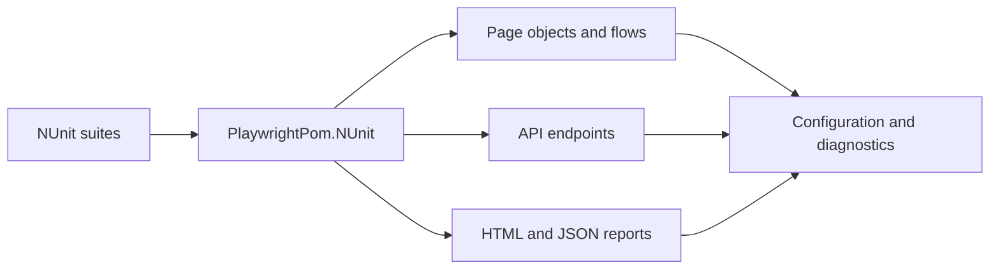

# Playwright C# POM Framework

Page Object Model framework for web automation and HTTP API testing on .NET 9 and Playwright 1.63. It ships with typed configuration, failure diagnostics, an offline HTML report, and pipelines for GitHub Actions and Azure DevOps.

The sample suites run against public demo systems so a fresh clone can execute without private credentials:

- Web: [SauceDemo](https://www.saucedemo.com)
- API: [DummyJSON](https://dummyjson.com)

Those demo usernames and passwords live in `config/appsettings.json` on purpose. Point `Web:BaseUrl`, `Api:BaseUrl`, and the account settings at your own environments through `appsettings.{Environment}.json` or `NEXUS_` variables before you use this against a real product.

## Layout

```text
src/PlaywrightPom.Core        configuration, logging, retries, soft asserts
src/PlaywrightPom.Web         pages, components, business flows
src/PlaywrightPom.Api         Playwright API client, endpoints, JSON schemas
src/PlaywrightPom.Reporting   HTML and JSON run reports
src/PlaywrightPom.NUnit       NUnit fixtures, traces, screenshots
tests/PlaywrightPom.Core.Tests
tests/PlaywrightPom.Web.Tests
tests/PlaywrightPom.Api.Tests
config/                       environment overlays
contracts/                    response schemas
runsettings/                  local, smoke, and CI profiles
.github/workflows/            pull request CI and nightly browser matrix
azure-pipelines.yml           Azure DevOps stages
```



## Prerequisites

- .NET 9 SDK
- PowerShell or the Playwright `.sh` driver script (installed with the build) for browsers

## Run

```bash
dotnet test tests/PlaywrightPom.Core.Tests/PlaywrightPom.Core.Tests.csproj -c Release
dotnet test tests/PlaywrightPom.Api.Tests/PlaywrightPom.Api.Tests.csproj -c Release --settings runsettings/ci.runsettings
./scripts/install-browsers.sh chromium
NEXUS_ENVIRONMENT=CI BROWSER=chromium dotnet test tests/PlaywrightPom.Web.Tests/PlaywrightPom.Web.Tests.csproj -c Release --settings runsettings/ci.runsettings
```

Smoke only:

```bash
dotnet test PlaywrightPom.sln -c Release --settings runsettings/smoke.runsettings
```

Headed debugging:

```bash
HEADED=1 dotnet test tests/PlaywrightPom.Web.Tests/PlaywrightPom.Web.Tests.csproj -c Release --settings runsettings/local.runsettings --filter "TestCategory=Smoke"
```

`BROWSER` accepts `chromium`, `firefox`, or `webkit`. `HEADED=1` shows the browser. `NEXUS_ENVIRONMENT` selects `appsettings.Development.json`, `appsettings.Staging.json`, or `appsettings.CI.json`.

Override a single setting without editing JSON:

```bash
NEXUS_Web__BaseUrl=https://staging.example NEXUS_Api__BaseUrl=https://api.staging.example dotnet test
```

## What a failure leaves behind

Failed web tests capture a full-page screenshot and a Playwright trace. Every suite writes:

- `artifacts/reports/web-report.html` and `web-report.json`
- `artifacts/reports/api-report.html` and `api-report.json`
- `artifacts/logs/framework-*.log`
- TRX files under `artifacts/test-results` when a runsettings file is used

Open a trace with PowerShell when it is installed:

```bash
pwsh tests/PlaywrightPom.Web.Tests/bin/Release/net9.0/playwright.ps1 show-trace artifacts/traces/<file>.zip
```

API calls retry transient `GET` responses (`408`, `429`, `5xx`) with exponential backoff. Logs pass through a redactor for bearer tokens, JSON secrets, and password query values.

## Adding a screen

1. Create a page under `src/PlaywrightPom.Web/Pages` and keep locators on the page, not in the test.
2. Put a multi-page journey in `Flows`.
3. Add an NUnit fixture that extends `BaseUiTest`.

```csharp
public sealed class LoginPage : BasePage
{
    public LoginPage(IPage page) : base(page) { }
    public override string RelativePath => "/";
    public Task SignInAsync(string user, string password) =>
        TestSession.Steps.StepAsync($"Sign in as {user}", async () =>
        {
            await Page.Locator("#user-name").FillAsync(user);
            await Page.Locator("#password").FillAsync(password);
            await Page.Locator("#login-button").ClickAsync();
        });
}
```

## Adding an API check

1. Add a model and an endpoint method that returns `ApiResponse<T>`.
2. Store the contract in `contracts/`.
3. Assert status and schema from a class that extends `BaseApiTest`.

```csharp
var response = await new ProductsEndpoint(Client).GetAsync(1);
await response.ShouldHaveStatus(200).ShouldMatchSchemaAsync("product.schema.json");
```

## Pipelines

| File | What it runs |
| --- | --- |
| `.github/workflows/ci.yml` | Unit, API, and Chromium web on every pull request |
| `.github/workflows/nightly.yml` | Chromium, Firefox, and WebKit, plus API contract tests |
| `azure-pipelines.yml` | Build, then unit, API, and web with TRX publishing |

Docker uses the matching Playwright image:

```bash
docker compose build
docker compose run --rm tests
```

## Categories

`Unit`, `Api`, `Web`, `Smoke`, `Regression`, `Contract`, and `Critical`. Case ids such as `WEB-001` are NUnit properties and show up in the HTML report.
